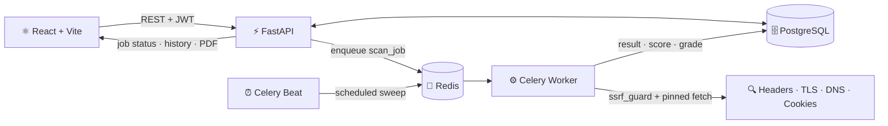

<div align="center">



<br/>

<a href="#-04--quick-start"></a>
<a href="#-03--how-it-works"></a>
<a href="#-05--api-surface"></a>
<a href="https://github.com/arman080325/SiteShield-Web/issues"></a>

<br/><br/>


<a href="https://github.com/arman080325/SiteShield-Web/actions/workflows/ci.yml"></a>

</div>


## ◈ 01 · The mission

**SiteShield is a multi-tenant security-posture monitor for the public face of your website.**
Add a domain, fire a scan, and a Celery worker inspects what any visitor's browser can see — HTTP security headers, TLS, DNS & email records and cookie flags. The results are rolled into a weighted **A–F grade**, kept as history, re-checked on a schedule by Celery Beat, and exportable as a **PDF report**.

<table>
<tr>
<td width="25%" align="center"><h3>🔍</h3><b>Inspect</b><br/><sub>4 categories · 16 individual checks</sub></td>
<td width="25%" align="center"><h3>🎯</h3><b>Grade</b><br/><sub>weighted score → A, B, C, D, E, F or N/A</sub></td>
<td width="25%" align="center"><h3>⏰</h3><b>Watch</b><br/><sub>scheduled sweeps · history · trend chart</sub></td>
<td width="25%" align="center"><h3>📄</h3><b>Report</b><br/><sub>one-click PDF for every domain</sub></td>
</tr>
</table>

<div align="center">
  
  <sub><i>The SiteShield dashboard — every domain, its latest grade, and a one-click rescan.</i></sub>
</div>

### Watch a scan happen

<div align="center">
  
</div>

> Each scan is an asynchronous **job**: the API answers `202 Accepted` immediately, the dashboard polls `GET /domains/scan-jobs/{job_id}`, and the finished result lands in scan history.


## ◈ 02 · What gets inspected

<div align="center">
  
</div>

<table>
<tr>
<th align="left">Category</th><th align="center">Weight</th><th align="left">Checks performed</th>
</tr>
<tr>
<td>🧱 <b>HTTP security headers</b></td><td align="center"><code>35%</code></td>
<td>
<code>Content-Security-Policy</code> <sub>25 pts</sub> ·
<code>Strict-Transport-Security</code> <sub>20</sub> ·
<code>X-Frame-Options</code> <sub>15</sub> ·
<code>X-Content-Type-Options</code> <sub>15</sub> ·
<code>Referrer-Policy</code> <sub>15</sub> ·
<code>Permissions-Policy</code> <sub>10</sub>
</td>
</tr>
<tr>
<td>🔐 <b>TLS / SSL</b></td><td align="center"><code>30%</code></td>
<td>Certificate validation · valid certificate · certificate expiry · negotiated protocol version</td>
</tr>
<tr>
<td>📨 <b>DNS &amp; email</b></td><td align="center"><code>20%</code></td>
<td><code>SPF</code> <sub>35 pts</sub> · <code>DMARC</code> <sub>40</sub> · <code>CAA</code> <sub>25</sub> — a lookup that <i>fails</i> is excluded rather than scored as missing</td>
</tr>
<tr>
<td>🍪 <b>Cookies</b></td><td align="center"><code>15%</code></td>
<td><code>Secure</code> · <code>HttpOnly</code> · <code>SameSite</code> on every <code>Set-Cookie</code> (a site that sets no cookies is handled explicitly)</td>
</tr>
</table>

### The grade ladder

<div align="center">


</div>

> [!NOTE]
> **Honest scoring.** If a category can't be reached (timeout, refused connection) it is dropped and the remaining weights are re-normalised, so *"couldn't test"* is never confused with *"tested and failed"*. When nothing could be scored, the grade is **N/A** instead of a misleading **F**.


## ◈ 03 · How it works

<div align="center">
  
</div>

<table>
<tr><td>

**① Request** — a signed-in user hits *Scan*; FastAPI verifies the JWT and that the domain belongs to them.<br/>
**② Queue** — a `scan_jobs` row is created, a 5-minute per-host cooldown is set in Redis, and the Celery task is enqueued.<br/>
**③ Scan** — a worker resolves the target through the SSRF guard, pins the peer IP and runs all four category scanners.<br/>
**④ Store** — the result, weighted score and grade are persisted; job progress and errors are recorded along the way.<br/>
**⑤ Poll** — the dashboard polls the job until it finishes, then refreshes history and the score-trend chart.<br/>
**⑥ Repeat** — Celery Beat sweeps every monitored domain every `SCAN_INTERVAL_SECONDS`, honouring opt-outs, dedupe and cooldowns.

</td></tr>
</table>

<details>
<summary><b>🗺️ Prefer a plain diagram? Expand the Mermaid version</b></summary>
<br/>



</details>


## ◈ Defence in depth

A tool that makes outbound requests on a user's behalf is itself a target. SiteShield treats every scan request as untrusted input.

<div align="center">
  
</div>

| Layer | What it stops | Where it lives |
|---|---|---|
| 🚦 **Rate limiting** | Signup `5/hour`, login `5/min · 20/hour`, scans `30/hour` per user — JSON `429` with `Retry-After` | `app/core/ratelimit.py` (slowapi + Redis) |
| 🔑 **JWT + bcrypt** | Plain-text passwords and unauthenticated access to protected routes | `app/auth/` |
| 🧍 **Ownership scoping** | IDOR — another tenant's domain simply returns `404` | `app/domains/`, `app/scanner/router.py` |
| 🙅 **Opt-out list** | Scanning hosts listed in `scan_opt_outs` | `scan_opt_outs` table |
| ♻️ **Dedupe + cache** | Duplicate jobs; a scan younger than 5 minutes is returned as `cached` | `app/scanner/router.py` |
| ⏳ **Cross-tenant cooldown** | Hammering one hostname — 300 s Redis cooldown shared by all users | Redis `scan:cooldown:{host}` |
| 🧭 **SSRF guard** | Private, loopback, link-local, reserved & metadata IPs, non-80/443 ports, `.local`/`.internal` hosts | `app/scanner/net/ssrf_guard.py` |
| 📌 **Peer pinning** | DNS-rebinding — the connected peer IP is re-verified, failing closed | `app/scanner/net/http_fetch.py` |
| 🧾 **Hardened API responses** | `nosniff`, `no-referrer`, strict CSP on JSON and `no-store` on sensitive responses | `app/main.py` |


## ◈ 04 · Quick start

### 🐳 Option A — the whole stack in one command

```bash
git clone https://github.com/arman080325/SiteShield-Web.git
```

```bash
cd SiteShield-Web && docker compose up --build
```

Compose brings up **six services** — `frontend`, `backend`, `worker`, `beat`, `redis`, `postgres` — and the backend runs Alembic migrations on boot.

| Service | URL |
|---|---|
| 🖥️ Dashboard | <http://localhost:8080> |
| ⚡ API | <http://localhost:8000> |
| 📘 Swagger docs | <http://localhost:8000/docs> |
| 💓 Health check | <http://localhost:8000/health> |

Stop with `docker compose down` (add `-v` only if you really want to wipe the local PostgreSQL volume).

<details>
<summary><b>🧩 Option B — run every service by hand</b></summary>
<br/>

**1 · Redis**

```bash
docker run -d --name siteshield-redis -p 6379:6379 redis:8-alpine
```

**2 · Backend API** (SQLite is used by default when no `DATABASE_URL` is set)

```bash
cd backend
python -m venv venv
source venv/bin/activate          # Windows: .\venv\Scripts\Activate.ps1
pip install -r requirements-dev.txt
uvicorn app.main:app --reload
```

**3 · Celery worker** (new terminal, same venv)

```bash
cd backend
celery -A app.celery_app.celery_app worker --loglevel=info
```

On Windows add `--pool=solo`.

**4 · Celery Beat** for scheduled monitoring (new terminal)

```bash
cd backend
celery -A app.celery_app.celery_app beat --loglevel=info
```

**5 · Frontend** (new terminal)

```bash
cd frontend
npm install
npm run dev
```

The Vite dev server runs on <http://localhost:5173>.

</details>

<details>
<summary><b>⚙️ Configuration reference</b> — <code>backend/.env</code> (see <code>backend/.env.example</code>)</summary>
<br/>

| Variable | Default | Purpose |
|---|---|---|
| `DATABASE_URL` | `sqlite:///./siteshield.db` | SQLAlchemy URL — PostgreSQL in Docker |
| `REDIS_URL` | `redis://localhost:6379/0` | Celery broker, cooldowns and rate-limit storage |
| `JWT_SECRET` | dev value | **Always override outside local development** |
| `JWT_ALGORITHM` | `HS256` | Token signing algorithm |
| `ACCESS_TOKEN_EXPIRE_MINUTES` | `60` | Access-token lifetime |
| `CORS_ORIGINS` | `http://localhost:5173` | Comma-separated allowed origins |
| `SCAN_INTERVAL_SECONDS` | `120` | Celery Beat sweep interval — raise to `86400` for daily |
| `SCANNER_USER_AGENT` | `SiteShieldBot/2.0 (…)` | User-Agent sent to scanned sites |
| `DOCS_ENABLED` | `true` | Toggle `/docs`, `/redoc` and `/openapi.json` |
| `RUN_MIGRATIONS` | — | Set to `1` to run `alembic upgrade head` on container start |

</details>

> [!IMPORTANT]
> Never commit a real `.env`. The `JWT_SECRET` default exists only so the app boots locally.


## ◈ 05 · API surface

Interactive docs live at **`/docs`** whenever `DOCS_ENABLED=true`.

| Method | Endpoint | What it does |
|:---:|---|---|
|  | `/auth/signup` | Create an account <sub>(5/hour)</sub> |
|  | `/auth/login` | Exchange credentials for a JWT <sub>(5/min · 20/hour)</sub> |
|  | `/auth/me` | Current user |
|  | `/domains` | Add a domain |
|  | `/domains` · `/domains/{id}` | List your domains / fetch one |
|  | `/domains/{id}/monitoring` | Toggle scheduled monitoring |
|  | `/domains/{id}` | Remove a domain and its history |
|  | `/domains/{id}/scan` | Queue a scan → `202` job · `200` existing job or cached result · `429` cooldown <sub>(30/hour)</sub> |
|  | `/domains/scan-jobs/{job_id}` | Poll job status and progress |
|  | `/domains/{id}/scans` | Scan history |
|  | `/domains/{id}/report` | Download the PDF report |
|  | `/health` | Liveness probe |


## ◈ 06 · Tech stack

<div align="center">


</div>

| Layer | Built with |
|---|---|
| **Frontend** | React 19 · Vite · Tailwind CSS · React Router · Chart.js / react-chartjs-2 |
| **API** | FastAPI · Pydantic · SQLAlchemy · Alembic · slowapi |
| **Auth** | JWT · bcrypt |
| **Jobs** | Celery worker + Celery Beat on Redis |
| **Scanning** | HTTPX · Python `ssl` / `socket` · dnspython |
| **Reports** | ReportLab |
| **Data** | PostgreSQL 16 (Docker) · SQLite (local dev) |
| **Quality** | Pytest · Respx · Freezegun · Ruff · ESLint · GitHub Actions |
| **Delivery** | Docker Compose · Nginx-served frontend build |


## ◈ 07 · Tests & quality gates

```bash
make test    # pytest + frontend production build
```

```bash
make lint    # ruff check + eslint
```

```bash
make fmt     # ruff format
```

The backend suite covers the scanners, auth & domain API, scan-job lifecycle, rate limits, security headers, PDF reports, Alembic migrations and a dedicated **SSRF suite** (loopback, private ranges, IPv4-mapped IPv6, metadata IPs, blocked ports and suffixes). CI runs it against a real PostgreSQL service, then lints and builds the frontend.


## ◈ 08 · Roadmap

```diff
+ Repository foundation · backend / frontend structure
+ JWT authentication and protected routes
+ User-scoped domain management
+ HTTP security-header scanning
+ TLS, DNS / email and cookie checks
+ Weighted A–F scoring with unreachable-category handling
+ Redis-backed Celery scan jobs with dedupe and cooldowns
+ Scheduled monitoring with Celery Beat
+ Scan history and trend visualisation
+ PDF reporting
+ SSRF guard, anti-rebinding and API rate limits
- Production deployment and operational hardening
- Regression alerts and notification delivery
```

<sub>`+` shipped &nbsp;·&nbsp; `-` up next — the full build log lives in <a href="PROGRESS.md"><b>PROGRESS.md</b></a>.</sub>

<details>
<summary><b>📁 Repository map</b></summary>
<br/>

```text
SiteShield-Web/
├── backend/
│   ├── app/
│   │   ├── auth/            # signup, login, JWT, password hashing
│   │   ├── domains/         # domain CRUD + monitoring toggle
│   │   ├── scanner/
│   │   │   ├── net/         # ssrf_guard.py · http_fetch.py (pinned, anti-rebinding)
│   │   │   ├── headers.py   # HTTP security headers
│   │   │   ├── tls.py       # certificate + protocol
│   │   │   ├── dns_scan.py  # SPF · DMARC · CAA
│   │   │   ├── cookies.py   # Secure · HttpOnly · SameSite
│   │   │   ├── tasks.py     # Celery scan task, weighting, scheduled sweep
│   │   │   └── router.py    # scan, job status, history, report endpoints
│   │   ├── reports/         # ReportLab PDF generation
│   │   ├── core/            # rate limiting, Redis client
│   │   ├── tests/           # pytest suite
│   │   ├── main.py · models.py · schemas.py · config.py · celery_app.py
│   ├── alembic/             # migrations: baseline · scan_jobs · scan_opt_outs
│   ├── Dockerfile · entrypoint.sh · requirements*.txt
├── frontend/
│   ├── src/
│   │   ├── api/             # client, auth, domains, job polling
│   │   ├── components/      # GradeBadge, ScanResult, ScoreTrendChart, …
│   │   ├── context/         # auth context
│   │   └── pages/           # Login · Signup · Dashboard · DomainDetail
│   ├── Dockerfile · nginx.conf
├── .github/
│   ├── workflows/ci.yml
│   └── readme/              # animated SVGs used by this README
├── docker-compose.yml · Makefile · PROGRESS.md
```

</details>


> [!WARNING]
> **Scan responsibly.** Only scan domains you own or are explicitly authorised to assess. SiteShield checks *publicly observable configuration*; it is not a penetration test, code audit or incident-response tool, and automated findings should be reviewed before you act on them.

## ◈ Author

<div align="center">


<sub>Computer Science &amp; Engineering · Cybersecurity · Full-stack development</sub>

<br/><br/>

<a href="https://github.com/arman080325"></a>

</div>

## ◈ License

No license file has been added yet. Until one is, the source is **not** licensed for unrestricted reuse.


<div align="center">

**SiteShield** — *make your website's security posture visible.*

<sub>If SiteShield helped you, a ⭐ on the repo keeps the radar spinning.</sub>

</div>
