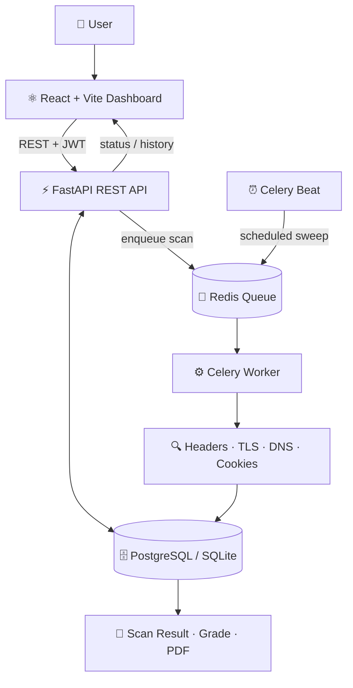

<div align="center">

# 🛡️ SiteShield

### Website Security Posture · Continuous Monitoring · Actionable Intelligence

**Know your website's security posture before someone else finds the gaps.**

A multi-tenant security monitoring platform that audits publicly observable website configuration, assigns a weighted A–F security grade, preserves scan history, and continuously watches for changes — powered by FastAPI, React, Celery, and Redis.

<br/>

[](https://www.python.org/)
[](https://fastapi.tiangolo.com/)
[](https://react.dev/)
[](https://docs.celeryq.dev/)
[](https://redis.io/)
[](https://www.postgresql.org/)
[](https://www.docker.com/)

<br/>

[**Explore the repository**](https://github.com/arman080325/SiteShield-Web)
&nbsp; • &nbsp;
[**Setup guide**](#-getting-started)
&nbsp; • &nbsp;
[**Report an issue**](https://github.com/arman080325/SiteShield-Web/issues)

</div>

---

## 👁️ At a glance

SiteShield helps website owners understand and improve their external security posture. Add a domain, run a scan, review evidence across four categories, and follow its security grade as monitoring builds a history over time.

<div align="center">
  
  <sub>SiteShield — security posture dashboard</sub>
</div>

## ✨ What SiteShield does

| Capability | Description |
|---|---|
| 🔐 **Account security** | JWT-based signup/login, bcrypt password hashing, protected API routes |
| 🧩 **Multi-tenant domains** | Add and manage domains with user-scoped data access |
| 🔍 **Four-category scanning** | Inspect HTTP headers, TLS, DNS/email configuration, and cookie security |
| 🎯 **Weighted security grade** | Combine category scores into an overall score and A–F grade |
| ⚙️ **Background scan jobs** | Queue scans through Redis and execute them with Celery workers |
| ⏰ **Scheduled monitoring** | Celery Beat periodically queues scans for monitored domains |
| 📈 **Scan history & trends** | Persist scan results and explore historical posture changes |
| 📄 **PDF reporting** | Generate a shareable report for a domain scan |
| 🛡️ **Defensive safeguards** | Target validation and SSRF protections help prevent unsafe scan destinations |

## 🔬 What gets checked?

SiteShield currently evaluates four security categories. Each category contains individual checks and contributes to the combined grade.

<box>
</box>

| Category | Weight | Example signals |
|---|---:|---|
| **HTTP security headers** | 35% | Content-Security-Policy, HSTS, X-Frame-Options, X-Content-Type-Options, Referrer-Policy, Permissions-Policy |
| **TLS / SSL** | 30% | Certificate validity and expiry, TLS connection and protocol information |
| **DNS & email** | 20% | SPF, DMARC, and CAA configuration |
| **Cookies** | 15% | Secure, HttpOnly, and SameSite attributes |

### Overall grade bands

| Grade | Score | Meaning |
|:---:|---:|---|
| <span style="color:#16a34a">**A**</span> | 90–100 | Strong observed posture |
| **B** | 75–89 | Good, with improvements possible |
| **C** | 60–74 | Several gaps deserve attention |
| **D** | 40–59 | Significant weaknesses observed |
| **E** | 20–39 | Major configuration gaps |
| **F** | 0–19 | Weak observed posture |
| **N/A** | — | No category could be meaningfully scored |

**Scoring detail:** category weights are re-normalized when a category is unreachable. A connection failure is not treated as the same thing as a successfully tested configuration that fails a security check.

## 🏗️ How the platform works

Scans run asynchronously so an API request does not have to wait for every network check to finish.



**The scan lifecycle**

1. A signed-in user requests a scan for a domain.
2. The API validates ownership and creates a scan job.
3. Redis queues the job and the API returns without waiting for the scan to finish.
4. A Celery worker performs the target checks and updates job progress.
5. The completed result is stored and can be retrieved through the API and dashboard.
6. Celery Beat periodically queues new jobs for domains with monitoring enabled.

## 🧰 Technology stack

| Layer | Technologies |
|---|---|
| Frontend | React 19, Vite, Tailwind CSS, React Router |
| Visualisation | Chart.js, react-chartjs-2 |
| Backend API | Python, FastAPI, Pydantic |
| Persistence | SQLAlchemy, SQLite for local development, PostgreSQL for containerised deployment |
| Authentication | JWT, bcrypt |
| Background processing | Celery, Redis, Celery Beat |
| Network checks | HTTPX, Python TLS/socket tools, dnspython |
| PDF reports | ReportLab |
| Database migrations | Alembic |
| Quality & tooling | Pytest, Ruff, Respx, Freezegun, ESLint |
| Local infrastructure | Docker Compose |

## 🚀 Getting started

### Prerequisites

- Python 3.11 or newer
- Node.js compatible with the Vite version in `frontend/package.json`
- Docker Desktop with Docker Compose (recommended for the complete stack)
- Git

### Option 1 — Start the complete stack with Docker

From the repository root:

```bash
docker compose up --build
```

Docker Compose starts the services defined in `docker-compose.yml`:

- Frontend
- FastAPI backend
- Celery worker
- Celery Beat scheduler
- Redis
- PostgreSQL

Open the application and API documentation:

| Service | Local URL |
|---|---|
| Frontend | http://localhost:8080 |
| Backend API | http://localhost:8000 |
| API documentation | http://localhost:8000/docs |
| Health check | http://localhost:8000/health |

Stop the stack with:

```bash
docker compose down
```

Use `docker compose down -v` only when you intentionally want to remove the persisted Compose volumes, including local PostgreSQL data.

### Option 2 — Run services individually

**1. Start Redis**

You can use Docker just for Redis:

```bash
docker run -d --name siteshield-redis -p 6379:6379 redis:8-alpine
```

**2. Set up the backend**

```bash
cd backend
python -m venv venv
```

Activate the environment:

```powershell
# Windows PowerShell
.\venv\Scripts\Activate.ps1
```

```bash
# macOS / Linux
source venv/bin/activate
```

Install development dependencies and start FastAPI:

```bash
pip install -r requirements-dev.txt
uvicorn app.main:app --reload
```

The local development configuration uses SQLite by default. Configure environment variables in your local `.env` when you need to override database, Redis, CORS, or other settings. Never commit secrets.

**3. Start the Celery worker**

Open another terminal, activate the backend virtual environment, and run:

```bash
cd backend
celery -A app.celery_app.celery_app worker --loglevel=info
```

On Windows, use the solo pool:

```powershell
celery -A app.celery_app.celery_app worker --loglevel=info --pool=solo
```

**4. Start Celery Beat**

For scheduled monitoring, open another backend terminal:

```bash
cd backend
celery -A app.celery_app.celery_app beat --loglevel=info
```

**5. Start the frontend**

In a separate terminal:

```bash
cd frontend
npm install
npm run dev
```

The Vite development server is configured for **http://localhost:5173**.

> **Development note:** the API, Redis, worker, scheduler, and frontend are separate processes in this setup. Keep the required terminals running while testing background and scheduled scans.

## 🧪 Tests and code quality

Backend development dependencies are defined in `backend/requirements-dev.txt`.

**Backend tests**

```bash
cd backend
python -m pytest -v
```

**Backend lint and formatting**

```bash
cd backend
ruff check .
ruff format .
```

**Frontend checks**

```bash
cd frontend
npm run lint
npm run build
```

## 🛡️ Security by design

SiteShield is built for defensive assessment of websites you own or are explicitly authorised to assess.

Security-related implementation includes:

- **Password protection:** passwords are hashed with bcrypt rather than stored in plaintext.
- **JWT authentication:** protected API routes verify signed access tokens.
- **Tenant isolation:** domain and scan operations are scoped to the authenticated owner to reduce IDOR risk.
- **SSRF safeguards:** scan targets are validated against unsafe destinations, including private or otherwise non-public address resolution.
- **Rate limiting:** API limits help constrain repeated requests.
- **HTTP security headers:** backend responses apply defensive response headers and no-store behaviour to sensitive responses.
- **Input and target validation:** domains are normalised and checked before scanning.

**Responsible use:** only scan domains for which you have permission. SiteShield performs external configuration checks; it is not a substitute for a full penetration test, source-code audit, or incident response process. Automated findings can be incomplete and should be reviewed before making security decisions.

## 🗺️ Project roadmap

The project has progressed through its core platform, four-category asynchronous scanning, and monitoring/history work. The next development focus is production hardening and delivery.

- [x] Repository foundation and backend/frontend structure
- [x] JWT authentication and protected routes
- [x] User-scoped domain management
- [x] HTTP security-header scanning
- [x] TLS, DNS/email, and cookie checks
- [x] Weighted A–F scoring with unreachable-category handling
- [x] Redis-backed Celery scan jobs
- [x] Scheduled monitoring with Celery Beat
- [x] Scan history and trend visualisation
- [x] PDF scan reporting
- [x] SSRF target safeguards and scan-job protections
- [ ] Complete production deployment and operational hardening
- [ ] Expand regression-alert delivery and notification workflows

## 📁 Repository structure

```text
SiteShield-Web/
├── backend/
│   ├── app/
│   │   ├── auth/                 # Signup, login, JWT and auth dependencies
│   │   ├── domains/              # Domain CRUD and monitoring controls
│   │   ├── scanner/
│   │   │   ├── net/              # HTTP fetching and SSRF safeguards
│   │   │   ├── headers.py        # HTTP security-header checks
│   │   │   ├── tls.py            # TLS / certificate checks
│   │   │   ├── dns_scan.py       # DNS and email configuration checks
│   │   │   ├── cookies.py        # Cookie security checks
│   │   │   ├── tasks.py          # Celery scan and scheduled-sweep tasks
│   │   │   └── router.py         # Scan, status and history endpoints
│   │   ├── reports/              # PDF report generation
│   │   ├── core/                 # Shared infrastructure and safeguards
│   │   ├── main.py               # FastAPI application
│   │   ├── models.py             # SQLAlchemy models
│   │   ├── schemas.py            # Pydantic schemas
│   │   ├── database.py           # Database engine and sessions
│   │   ├── config.py             # Environment-based settings
│   │   └── celery_app.py         # Celery configuration and schedule
│   ├── alembic/                  # Database migrations
│   ├── requirements.txt
│   ├── requirements-dev.txt
│   └── Dockerfile
├── frontend/
│   ├── src/
│   │   ├── api/                  # API client and endpoint helpers
│   │   ├── components/           # Reusable UI components
│   │   ├── context/              # Authentication context
│   │   ├── pages/                # Login, signup, dashboard, detail
│   │   ├── App.jsx
│   │   └── main.jsx
│   ├── package.json
│   └── vite.config.js
├── .github/workflows/            # CI workflow
├── docker-compose.yml            # Full local service stack
├── PROGRESS.md                   # Detailed development log
└── README.md
```

## 📚 Project documentation

- **[PROGRESS.md](PROGRESS.md)** — detailed build log, architecture notes, implementation decisions, and development workflow.
- **[Backend API docs](http://127.0.0.1:8000/docs)** — interactive Swagger documentation when the backend is running.
- **[Issues](https://github.com/arman080325/SiteShield-Web/issues)** — report bugs or suggest improvements.

## 👨‍💻 Author

<div align="center">

**Arman Ahemad Khan**

Computer Science & Engineering · Cybersecurity · Full-Stack Development

[](https://github.com/arman080325)

</div>

## 📄 License

No license file was found in the repository when this README was prepared. Until a license is added, do not assume the source is available for unrestricted reuse.

---

<div align="center">

**SiteShield — Make your website's security posture visible.**

<sub>Built with curiosity, security-first thinking, and a focus on continuous improvement.</sub>

</div>
